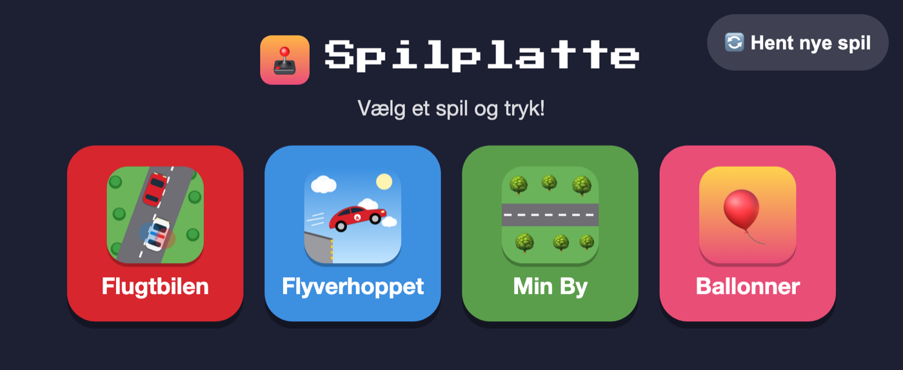

# Spilplatte

A home-screen web app where kids make their own games — by talking to Claude Code in Danish —
and play them on an old iPad running iOS 12. Hosted on GitHub Pages.



**Play:** https://duemunk.github.io/Spilplatte/ — on the iPad, open it in Safari and choose
*Share → Add to Home Screen* so it runs full screen like an app.

## How it works

- **Kids describe, Claude builds.** A kid writes (or dictates) in Danish in Claude Code. The
  `spil` skill (`.claude/skills/spil/`) takes over: it adapts to how the kid likes to work,
  helps pick a name, colours, an icon and sounds, builds the game, checks it, and pushes it.
- **No build step.** Plain HTML, CSS and ES2017 JavaScript so it runs on iOS 12 Safari and an
  original iPad Air. A GitHub Action checks every push for newer JavaScript syntax.
- **One shared engine.** `shared/engine.js` handles the canvas (a fixed 1024 × 768 world that
  fits any rotation), touch, the game loop, cached text and emoji, fun fonts, synthesized sound
  effects, saving progress, and the 🏠 / ↺ (start over) buttons.
- **Works offline.** A service worker (`sw.js`) caches every game; online it always fetches
  the newest version first.
- **Each kid owns their games.** A kid can only change games listed under their own name.

## Layout

```
index.html          start page (reads games.json)
games.json          the list of games: title, folder, icon, author, colour, assets
games/<name>/       one folder per game: index.html, game.js, icon.png, any assets
games/template/     copied to start a new game
shared/             engine, styles, fonts, icons, sound preview page
tools/              icon renderer and the in-chat sound board
sw.js               offline support
CLAUDE.md           the rules every game follows (iOS 12, performance, touch, fonts …)
```

## Preview locally

```bash
python3 -m http.server 8000
```

Then open http://localhost:8000/.
